# TravelMemory – AWS EC2 Deployment Documentation

This document describes how the TravelMemory MERN application was deployed on AWS EC2 with separate frontend and backend tiers, each scaled to two instances behind its own Application Load Balancer.

**Live application:** http://travelmemory-frontend-alb-2055907764.ap-south-1.elb.amazonaws.com

**Backend API (load balanced):** http://travelmemory-backend-alb-1521753337.ap-south-1.elb.amazonaws.com/trip

---

## 1. Architecture

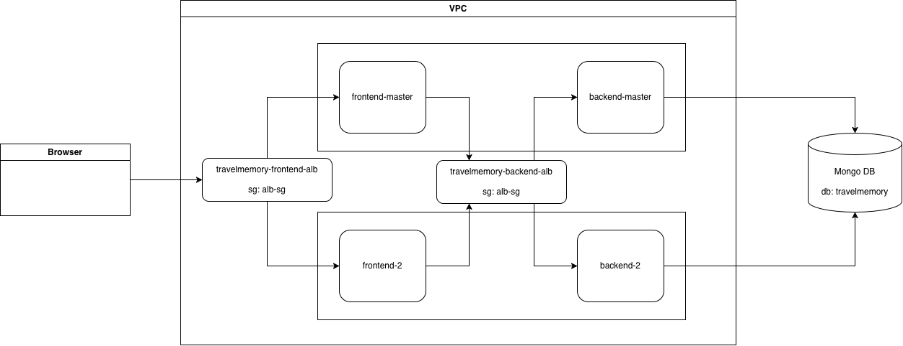

Request flow: **Browser → Frontend ALB → Frontend EC2 ×2 → Backend ALB → Backend EC2 ×2 → MongoDB Atlas**

The draw.io source file is included as `TravelMemory-architecture.drawio`.

| Component | Name | Details |
|---|---|---|
| Region | ap-south-1 (Mumbai) | All AWS resources |
| Database | MongoDB Atlas (M0 free cluster) | Database `travelmemory`, collection `trips` |
| Backend instances | `backend-master`, `backend-2` | Ubuntu 24.04, t2/t3.micro, Node.js 20 on port 3000 (systemd), Nginx reverse proxy on port 80 |
| Frontend instances | `frontend-master`, `frontend-2` | Ubuntu 24.04, t2/t3.micro, Nginx serving the React production build on port 80 |
| AMIs | `travelmemory-backend-ami`, `travelmemory-frontend-ami` | Images of the master instances, used to launch instance #2 of each tier |
| Target groups | `travelmemory-backend-tg`, `travelmemory-frontend-tg` | HTTP :80, health checks `/hello` (backend) and `/` (frontend) |
| Load balancers | `travelmemory-backend-alb`, `travelmemory-frontend-alb` | Internet-facing Application Load Balancers, HTTP :80 listener |
| Security groups | `alb-sg`, `launch-wizard-1` | See [Security](#8-security) |

Each pair of instances is placed in two different Availability Zones so the application keeps running if one zone fails.

> Note: The React app runs in the user's browser, so its API calls (axios) are sent from the browser to the backend load balancer. This is why the backend ALB is also internet-facing.

Configuration files used on the servers are in the [`deploy/`](deploy) folder.

---

## 2. MongoDB Atlas Setup

1. Created a free **M0** cluster on MongoDB Atlas (provider AWS, region Mumbai).
2. Created a database user and saved the username and password.
3. **Network Access → Add IP Address → Allow Access from Anywhere** (`0.0.0.0/0`), because EC2 instance IPs change.
4. **Connect → Drivers** → copied the connection string and added the database name `travelmemory`:

```
mongodb+srv://<username>:<password>@<cluster-host>/travelmemory
```

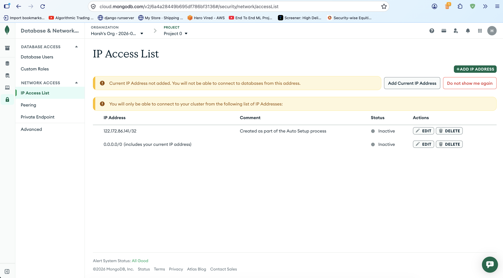

---

## 3. Backend Setup (backend-master)

### 3.1 Launch the instance

- AMI: Ubuntu Server 24.04 LTS, instance type t2.micro / t3.micro
- Key pair: `travelmemory-key` (RSA, .pem)
- Security group: SSH (22) from my IP, HTTP (80)
- An Elastic IP was associated so the public IP stays the same after restarts.

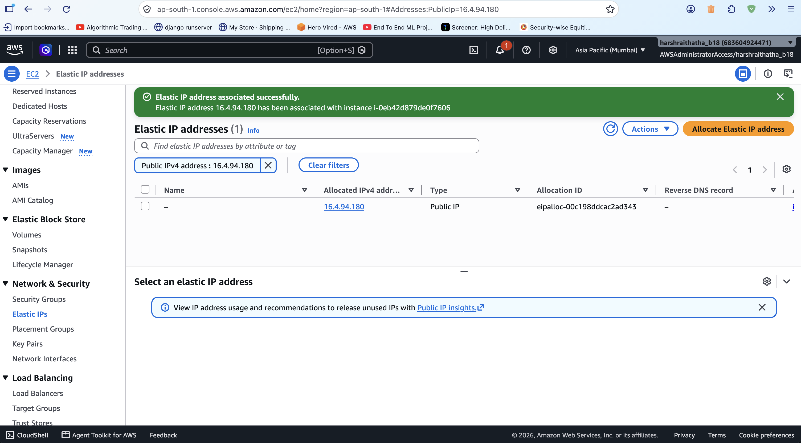

Connect from the local machine:

```bash
chmod 400 ~/.ssh/travelmemory-key.pem
ssh -i ~/.ssh/travelmemory-key.pem ubuntu@<backend-master-ip>
```

### 3.2 Install software

```bash
sudo apt update && sudo NEEDRESTART_MODE=a apt install -y nginx git
curl -fsSL https://deb.nodesource.com/setup_20.x | sudo -E bash -
sudo NEEDRESTART_MODE=a apt install -y nodejs
node -v && nginx -v
```

A 2 GB swap file was added because t2.micro has only 1 GB of RAM:

```bash
sudo fallocate -l 2G /swapfile && sudo chmod 600 /swapfile
sudo mkswap /swapfile && sudo swapon /swapfile
echo '/swapfile none swap sw 0 0' | sudo tee -a /etc/fstab
```

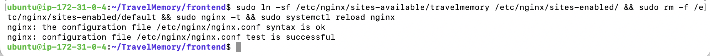

### 3.3 Configure the backend

```bash
git clone https://github.com/harshraithatha/TravelMemory.git
cd TravelMemory/backend
npm install
```

Created `backend/.env` with the database connection and port (template: [`deploy/backend.env.example`](deploy/backend.env.example)):

```
MONGO_URI='mongodb+srv://<username>:<password>@<cluster-host>/travelmemory'
PORT=3000
```

The real `.env` file is **not** committed to GitHub (it is listed in `.gitignore`).

### 3.4 Run the backend as a systemd service

systemd restarts the backend if it crashes and starts it automatically on boot. This matters because instances launched later from the AMI must start the backend without any manual steps.

Service file `/etc/systemd/system/travelmemory-backend.service` ([`deploy/travelmemory-backend.service`](deploy/travelmemory-backend.service)):

```ini
[Unit]
Description=TravelMemory Backend
After=network.target

[Service]
Type=simple
User=ubuntu
WorkingDirectory=/home/ubuntu/TravelMemory/backend
EnvironmentFile=/home/ubuntu/TravelMemory/backend/.env
ExecStart=/usr/bin/node index.js
Restart=always
RestartSec=5

[Install]
WantedBy=multi-user.target
```

```bash
sudo systemctl daemon-reload
sudo systemctl enable --now travelmemory-backend
sudo systemctl status travelmemory-backend
```

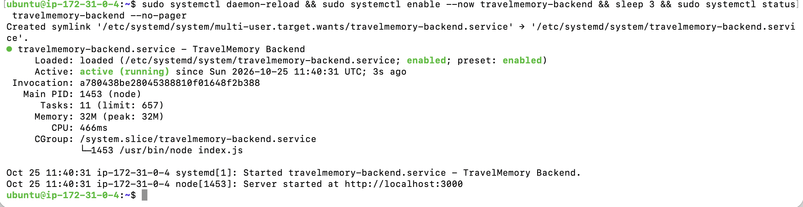

### 3.5 Nginx reverse proxy

Nginx listens on port 80 and forwards all requests to the Node.js backend on port 3000 ([`deploy/backend-nginx.conf`](deploy/backend-nginx.conf)):

```nginx
server {
    listen 80;
    server_name _;

    location / {
        proxy_pass http://localhost:3000;
        proxy_set_header Host $host;
        proxy_set_header X-Real-IP $remote_addr;
        proxy_set_header X-Forwarded-For $proxy_add_x_forwarded_for;
    }
}
```

```bash
sudo ln -sf /etc/nginx/sites-available/travelmemory /etc/nginx/sites-enabled/
sudo rm -f /etc/nginx/sites-enabled/default
sudo nginx -t && sudo systemctl reload nginx
```

Verified: `http://<backend-master-ip>/hello` returns `Hello World!` and `/trip` returns the trips from MongoDB.


---

## 4. Backend Scaling and Load Balancer

### 4.1 AMI and second instance

1. **EC2 → Instances → backend-master → Actions → Image and templates → Create image** → `travelmemory-backend-ami`.
2. Rebooting during image creation confirmed that systemd starts the backend automatically.
3. **AMIs → travelmemory-backend-ami → Launch instance from AMI** → `backend-2`, placed in a different Availability Zone, using the same security group.

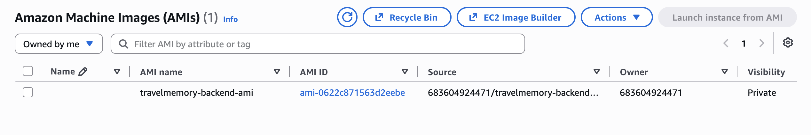


### 4.2 Target group and Application Load Balancer

1. Security group `alb-sg` was created with inbound HTTP (80) from anywhere.
2. Target group `travelmemory-backend-tg`: instances, HTTP :80, health check path `/hello`, registered `backend-master` and `backend-2`.
3. Application Load Balancer `travelmemory-backend-alb`: internet-facing, IPv4, all Availability Zones, security group `alb-sg`, listener HTTP :80 → `travelmemory-backend-tg`.

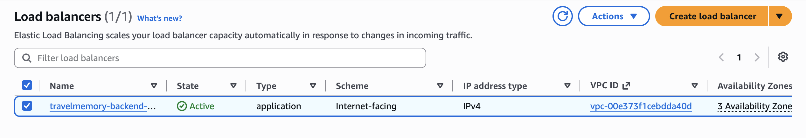
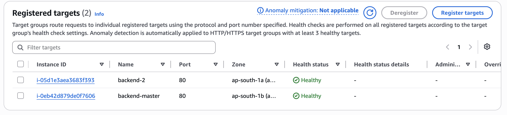
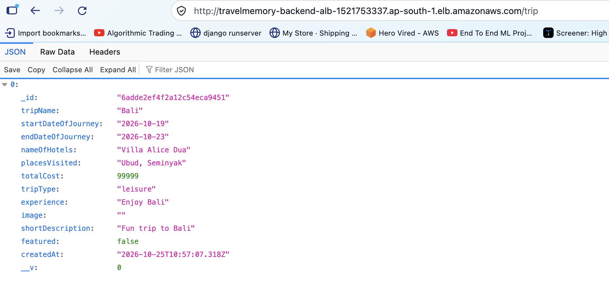

---

## 5. Frontend Setup (frontend-master)

### 5.1 Connect the frontend to the backend

`frontend/src/url.js` was updated so the frontend sends API requests to the backend load balancer:

```js
export const baseUrl = "http://travelmemory-backend-alb-1521753337.ap-south-1.elb.amazonaws.com";
```

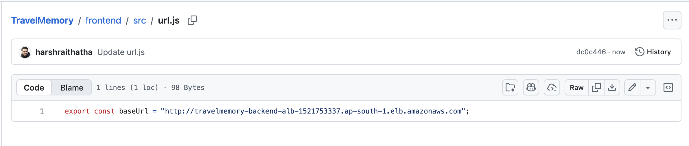

Because the backend load balancer was created before the frontend was built, its address was built into the frontend from the start, and the frontend AMI did not need to be rebuilt.

### 5.2 Launch, install and build

- Same AMI, instance type, key pair and security group as the backend.
- Installed Nginx, Git, Node.js 20 and a 2 GB swap file (same commands as in section 3.2).

```bash
git clone https://github.com/harshraithatha/TravelMemory.git
cd TravelMemory/frontend
npm install
npm run build
sudo rm -rf /var/www/html/*
sudo cp -r build/* /var/www/html/
```

The build finishes with "Compiled with warnings". The warnings are ESLint style notices and deprecated-package notices from the original project, and they do not affect the build.

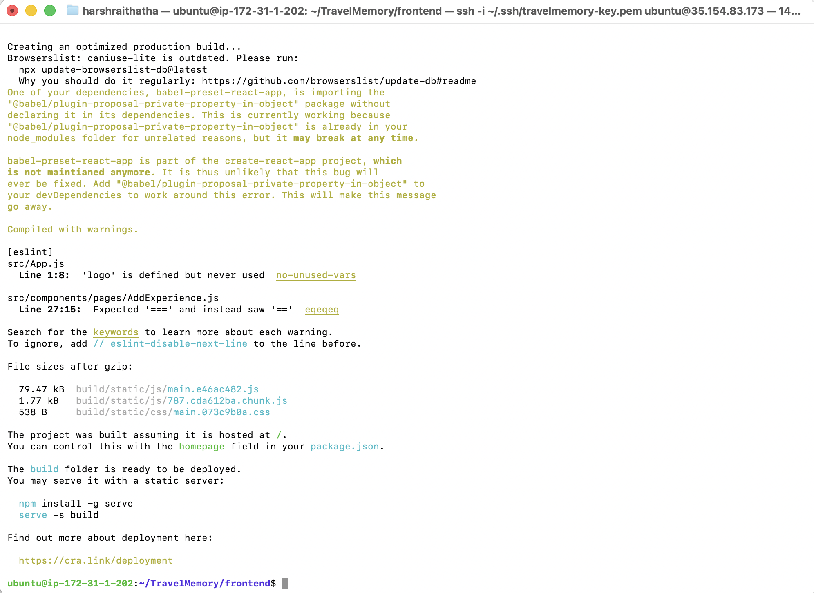

### 5.3 Nginx for the React app

`try_files` sends unknown paths to `index.html` so React Router pages (for example a trip's detail page) still work after a browser refresh ([`deploy/frontend-nginx.conf`](deploy/frontend-nginx.conf)):

```nginx
server {
    listen 80;
    server_name _;

    root /var/www/html;
    index index.html;

    location / {
        try_files $uri /index.html;
    }
}
```

```bash
sudo ln -sf /etc/nginx/sites-available/travelmemory /etc/nginx/sites-enabled/
sudo rm -f /etc/nginx/sites-enabled/default
sudo nginx -t && sudo systemctl restart nginx
```

Verified at `http://<frontend-master-ip>`: existing trips load, and a new experience can be added from the UI.

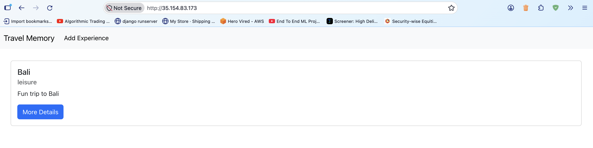
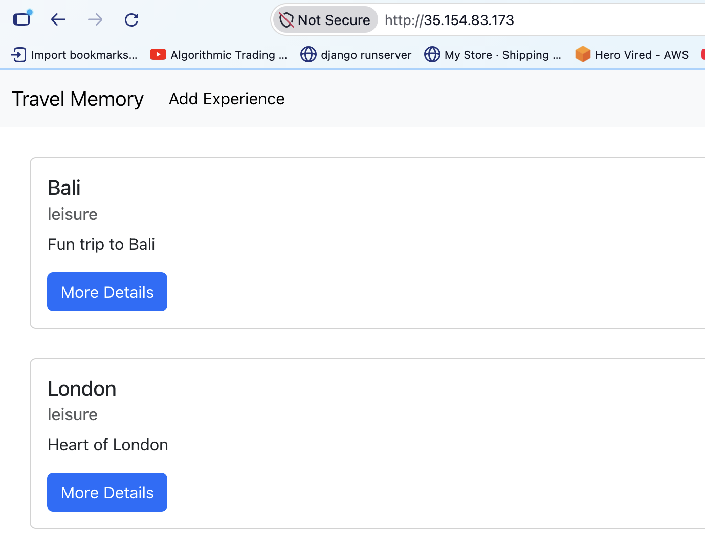

---

## 6. Frontend Scaling and Load Balancer

1. Created AMI `travelmemory-frontend-ami` from `frontend-master`.
2. Launched `frontend-2` from it in a different Availability Zone.
3. Target group `travelmemory-frontend-tg`: instances, HTTP :80, health check path `/`, registered `frontend-master` and `frontend-2`.
4. Application Load Balancer `travelmemory-frontend-alb`: internet-facing, all Availability Zones, security group `alb-sg`, listener HTTP :80 → `travelmemory-frontend-tg`.

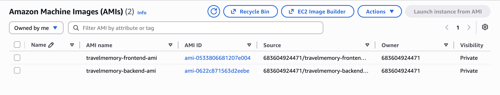
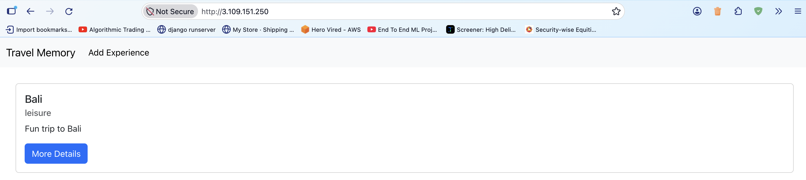
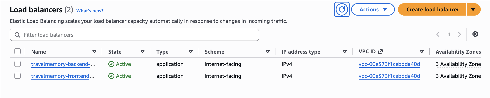
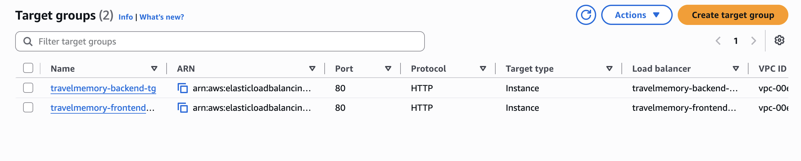

---

## 7. Final Verification

The application works end to end through both load balancers at
**http://travelmemory-frontend-alb-2055907764.ap-south-1.elb.amazonaws.com**

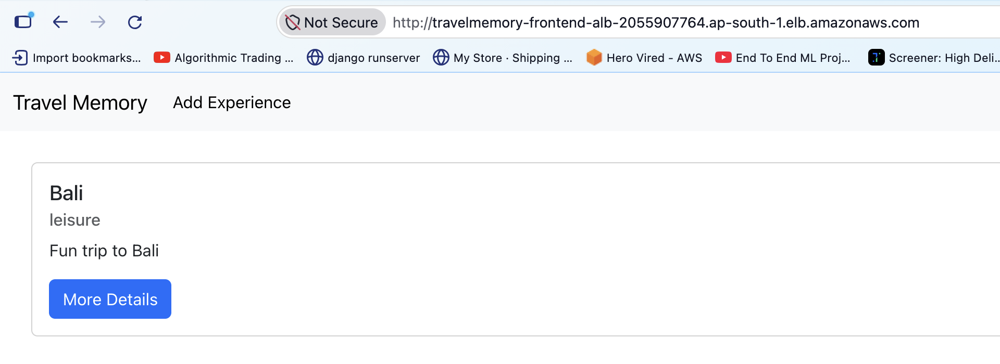
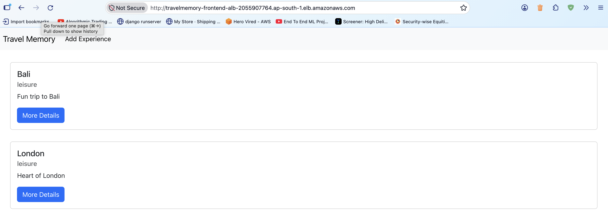
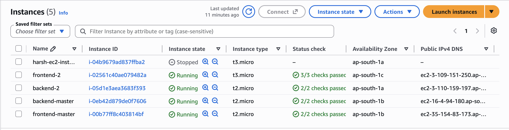
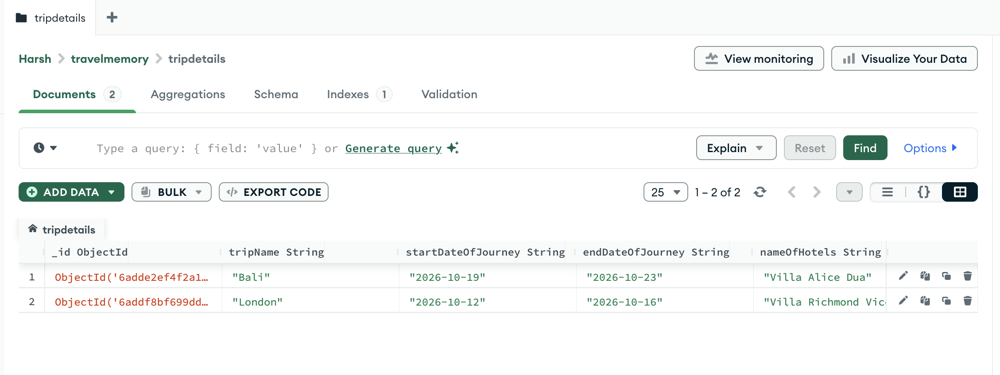

---

## 8. Security

| Security group | Inbound rules | Used by |
|---|---|---|
| `alb-sg` | HTTP 80 from `0.0.0.0/0` | Both load balancers |
| `launch-wizard-1` | HTTP 80 **only from `alb-sg`**; SSH 22 only from my IP | All four EC2 instances |

- The EC2 instances cannot be reached directly from the internet over HTTP; traffic must come through a load balancer.
- SSH is limited to my own IP address and requires the private key.
- Database credentials are kept in `.env` on the servers and are not committed to the repository.

AWS does not allow an existing IPv4 CIDR rule to be changed to a security-group source ("You may not specify a referenced group id for an existing IPv4 CIDR rule"), so the old HTTP rule was deleted and a new HTTP rule with source `alb-sg` was added.

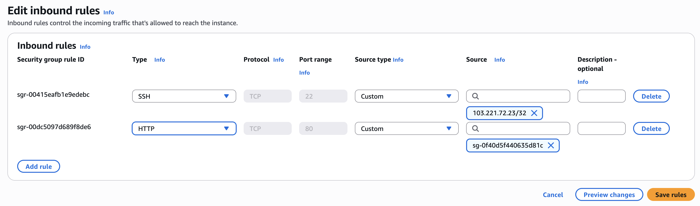
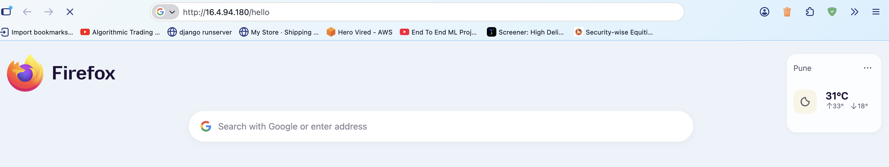

---

## 9. Scalability and Resilience

- **Horizontal scaling:** each tier runs on two instances behind its own load balancer. More instances can be launched from the AMIs and registered in the target groups.
- **High availability:** instances are spread across two Availability Zones, and the ALBs route only to instances that pass health checks.
- **Self-healing processes:** systemd restarts the backend if it crashes and starts it on boot.
- **Managed database:** MongoDB Atlas is shared by both backend instances, so all instances serve the same data.

### Possible improvements

- Use an Auto Scaling group with a launch template instead of manually launched instances.
- Add HTTPS with a custom domain through Cloudflare (optional in this assignment) or an ACM certificate on the ALB.
- Make the backend ALB internal and have the frontend Nginx proxy API calls to it, so the backend is not publicly reachable.
- Restrict MongoDB Atlas network access to the NAT/Elastic IPs instead of `0.0.0.0/0`.

---

## 10. Domain (Cloudflare)

Connecting a custom domain was optional for this assignment and was not done. The application is reachable through the frontend load balancer's DNS name. With a domain, the setup would be:

| Type | Name | Target |
|---|---|---|
| CNAME | `@` / `www` | Frontend ALB DNS name |
| CNAME | `api` | Backend ALB DNS name |

`url.js` would then point to `https://api.<domain>` and the frontend would be rebuilt.
